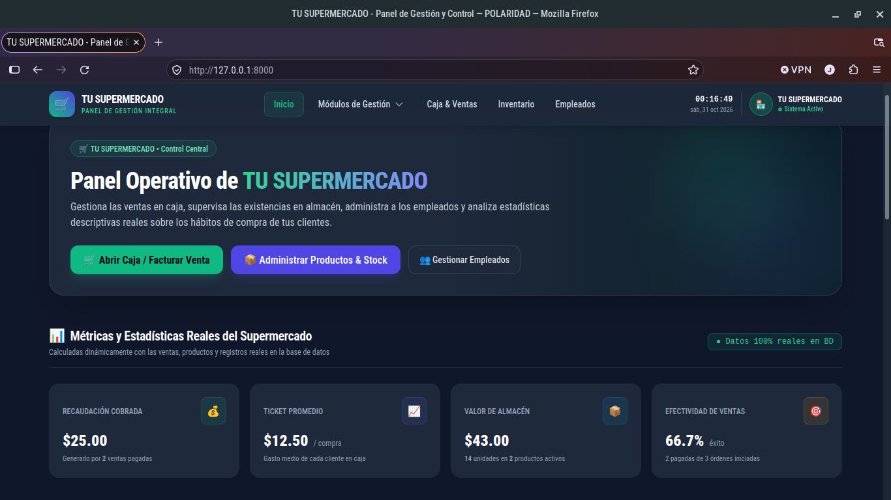
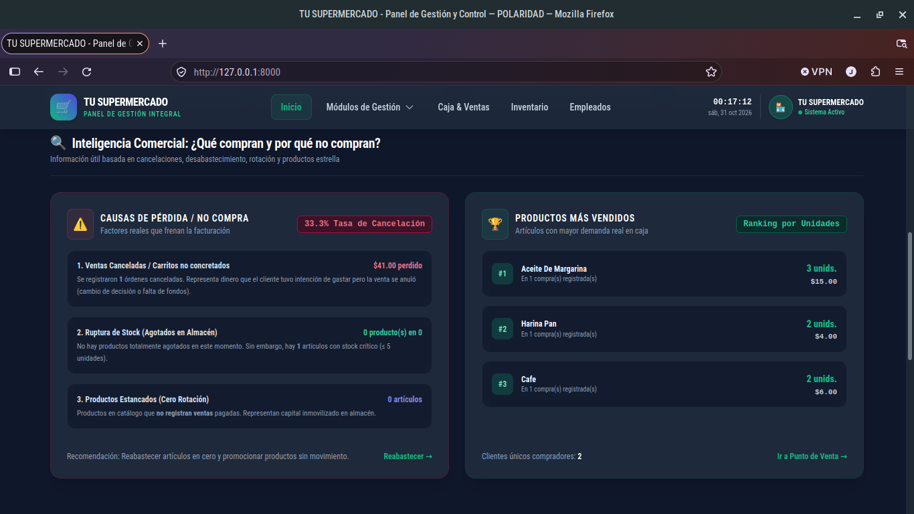
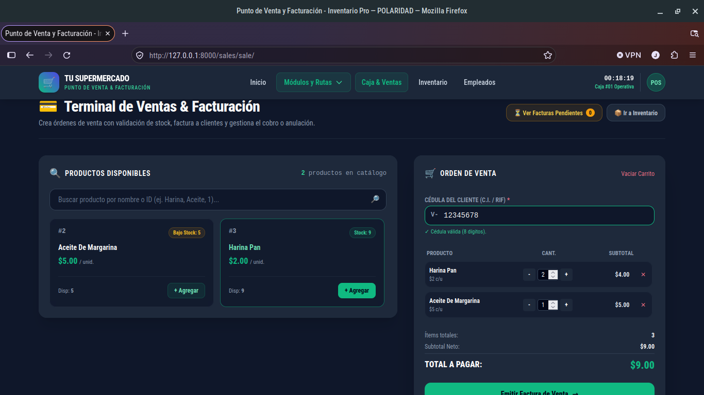
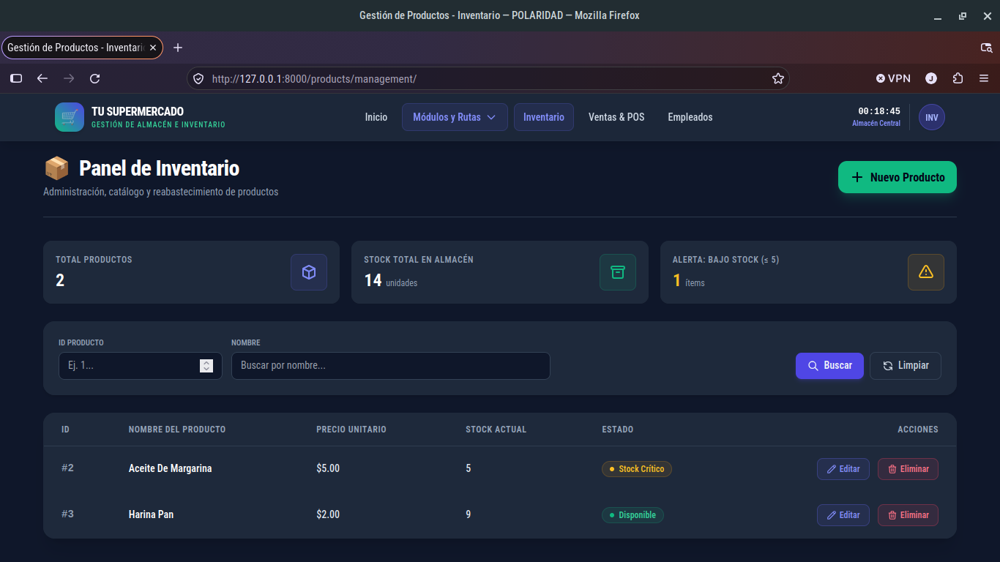
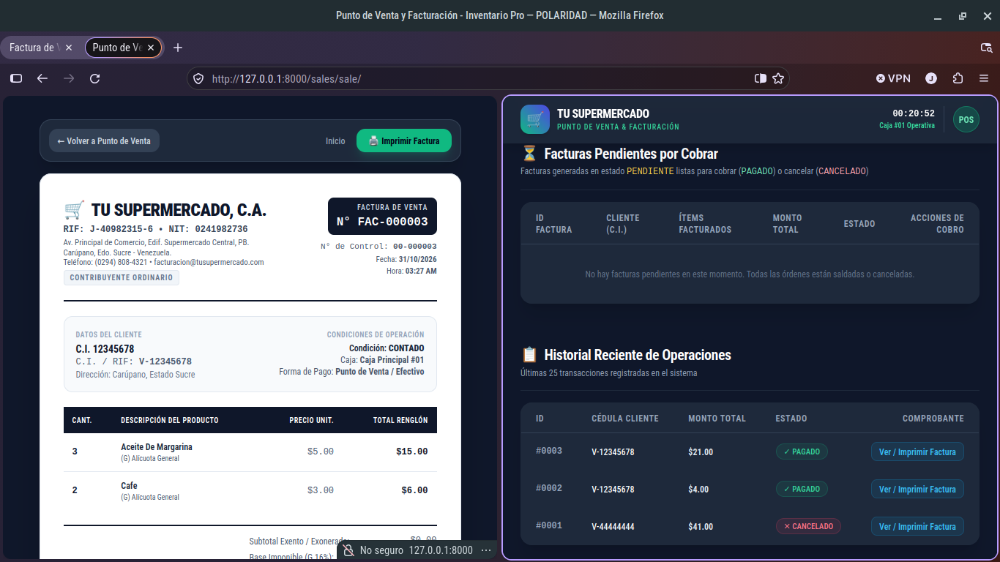
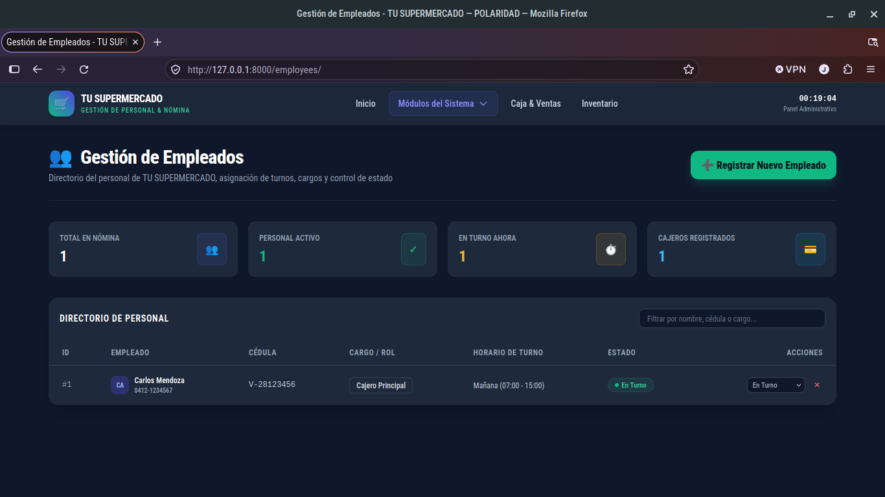

# 📦 Inventory System

MVP de sistema de control de inventario, reabastecimiento de mercancía desarrollado con una arquitectura limpia.

# Funcionalidades

* **Interfaz web**
* **Estadisticas en tiempo real**
* **Gestion de empleados**
* **Transacciones de caja**
* **Punto de venta digital y caja**
* **Gestion de inventario**
* **Facturas con autoimpresion**

# Plam futuro

* Automatizacion de reportes (PDF, Excel, Gmail)
* Tokens y soporte para empleados
* Integracion de chatbot

## Tecnologías utilizadas
* **Python 3.12**
* **FastAPI** (Framework web asíncrono)
* **SQLAlchemy** (ORM para la gestión de base de datos relacionales)
* **Pydantic** (Validación de datos y esquemas)
* **SQLite** (Base de datos local)

# Vista previa del sistema








## Cómo correr el proyecto localmente

1. Clona el repositorio:
   ```bash
   git clone https://github.com/juanjosehurtadohurtado03-lab/Inventory_system
   cd Inventory_system

2. ActivCrea y activa el entorno virtual:
    ```bash
    python3 -m venv venv
    source venv/bin/activate

3. Instala las dependencias:
    ```bash
    pip install -r requirements.txt

4. Cree el servidor de uvicorn:
    ```bash
    uvicorn app.main:app --reload

5. Abra su navegador y copie y pegue esta URL:
    http://127.0.0.1:8000/docs


